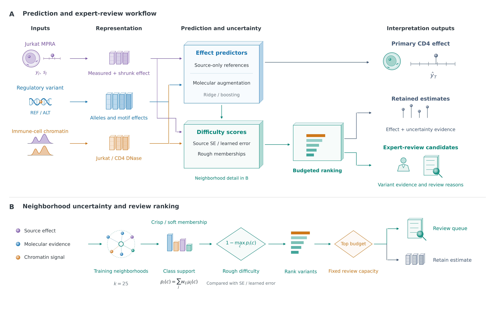

# Assessment of regulatory variant effect prediction and uncertainty between Jurkat and primary CD4 T cells using a framework incorporating NeuroJico for expert review prioritization

## Summary

We developed a computational framework to evaluate how well regulatory variant effects measured in Jurkat cells predict allelic effects in activated primary CD4 T cells. It uses published MPRA data, strong source-only references, molecular annotations, genomic locus separation, and explicit usefulness criteria. The framework creates an outcome-blind queue of variants for review and reports prediction error among retained estimates. Expert corrections and human benefit are not assumed.

The conceptual foundation is Hassanien’s NeuroSophic cognition model, which connects NeuroJico philosophy with uncertainty representation and human cognitive autonomy. Our framework incorporates NeuroJico principles by retaining evidence for human judgement when immune regulatory variant predictions are uncertain. [Hassanien (2025)](https://doi.org/10.33168/JLISS.2025.1110).

The evaluated cohort contains 18,134 variants across 322 locus groups. Molecular features did not meet the criterion of at least 5% lower prediction MSE than the strongest source-only reference. Rough-set prioritization also failed to improve retained error over the selected ordinary selector. These results support an evidence-based benchmark of model limitations and review prioritization.

Review budgets of 1%, 5% and 10% represent alternative workloads for inspecting predictions, with 5% designated as the primary comparison. They prioritize 31, 151 and 301 of the 3,006 confirmation variants, respectively. These percentages specify how many variants are flagged for review; they are separate from the 5% MSE improvement criterion and have no biological threshold interpretation. Figure 3 and Table S2 report prediction error among the remaining variants and the observed error captured by each review queue.



## Project structure

```text
main.py                         Study command-line interface
regulatory_model/
  config.json                   Fixed analysis settings
  data_prep.py                  Public MPRA effects and predictor whitelist
  liftover.py                   Coordinate and reference-allele verification
  annotations.py                Exact DNase extraction and checked joins
  dataset_cohorts.py             Cohort preparation and input provenance
  model.py                      Effect regressors and rough memberships
  benchmarking.py               Metrics, paired intervals, review cards
  evaluation.py                 Genomic grouping and operational classes
  replicates.py                 Report-only replicate sensitivity
  pipeline.py                   Model selection and held-out evaluation
  reporting.py                  Tables, numerical figures, architecture
  api.py                        In-memory fitting and prediction
  training.py                   Study orchestration exports
scripts/
  verify_run_inputs.py           Public downloads and checksum verification
  build_accessibility_schema.py  Standalone annotation preparation
  verify_benchmark.py            Study execution or report regeneration
  audit_replicates.py            Standalone replicate diagnostic
tests/                         Offline integrity and end-to-end tests
```

## Installation

Use Python 3.11. The exact dependency set is pinned in `requirements-lock.txt`; no foundation-model weights, API keys, or private datasets are required.

```bash
git clone https://github.com/Moustafazn/regulatory-variant-framework.git
cd regulatory-variant-framework
python3.11 -m venv .venv
source .venv/bin/activate
python -m pip install -r requirements-lock.txt
python -m pip install --no-deps --no-build-isolation -e .
python -m pip check
```

On Windows, activate with `.venv\Scripts\activate`. If a `pyBigWig` wheel is unavailable, compilation requires a C compiler and zlib development headers. The installation has been checked in an isolated Python 3.11 environment on macOS; other platforms may require those build tools.

Run the offline checks:

```bash
OPENBLAS_NUM_THREADS=1 OMP_NUM_THREADS=1 python -m pytest -q
```

## Usage

Download the public workbook, primary-cell normalized counts, coordinate chain, reference genome, and two DNase tracks:

```bash
python scripts/verify_run_inputs.py --download
```

Allow approximately 8 GB of free disk space. Downloads are checked against fixed SHA-256 values where supplied; the reference archive is checked against the UCSC checksum manifest. `data/public_input_manifest.json` records sources and hashes. Public hosts can impose access restrictions; files may also be downloaded from their source pages and placed at the paths listed by the setup script. Never substitute files with different checksums silently.

Run the complete study from raw inputs:

```bash
OPENBLAS_NUM_THREADS=1 OMP_NUM_THREADS=1 python main.py --output output/immune_transfer
```

Choose a fresh output directory for each run. For a computational smoke test, add `--max-rows 800`; capped results are not the full-cohort study. Input locations are configurable with `--data-root`, `--reference-fasta`, `--chain`, `--source-track`, and `--target-track`. `python main.py --help` lists all options.

Every complete run generates:

- Input, software, code and artifact hashes; cohort and locus split manifests.
- Development-selected models and review policies, and per-variant held-out predictions.
- Four main figures: `architecture`, `prediction`, `review`, and `reliability`, each in SVG, PDF, and PNG.
- Two main tables and three supplementary tables, organized below.
- Outcome-blind `review_cards.json`, replicate diagnostics, and `study_summary.md`.
- `paper_manifest.json`, mapping every manuscript figure and table to its source artifacts and hashes.

| Manuscript item | Contents | File |
|---|---|---|
| Table 1 | Data sources, cohort, and evaluation partitions | `cohort_table.csv` |
| Table 2 | Predictors, review scores, and selection rules | `comparator_table.csv` |
| Table S1 | Prediction performance and paired contrasts | `prediction_table.csv` |
| Table S2 | Review curves and the selected-policy contrast | `routing_table.csv` |
| Table S3 | Replicate agreement and calibration diagnostics | `reliability_table.csv` |

Regenerate every table and figure from saved results without fitting models again. The command checks input hashes before rendering:

```bash
python scripts/verify_benchmark.py --report-only output/immune_transfer
```

Use the source-assisted estimator directly:

```python
import pandas as pd
from regulatory_model import RegulatoryVariantModel

training = pd.read_csv("docs/templates/training_variants.csv")
candidates = pd.read_csv("docs/templates/candidate_variants.csv")
model = RegulatoryVariantModel(name="source_shrunk").fit(training)
predictions = model.predict(candidates)
```

The templates are synthetic schema demonstrations. Real inputs must have verified GRCh38 coordinates and matched source/target contexts. Candidate inputs must exclude target effects, target standard errors, covariance, and target replicate measurements. Methods and interpretation are detailed in [METHODS.md](docs/METHODS.md). The complete [Word manuscript](paper/manuscript.docx) and [supplementary material](paper/supplementary_material.docx) present the study. The paper folder also contains 42 reference records and their verification sources.

## Citation

The manuscript is a draft and has no assigned journal citation or DOI. Cite the repository when using this implementation:

```bibtex
@software{regulatory_variant_framework,
  title = {Assessment of regulatory variant effect prediction and uncertainty between Jurkat and primary CD4 T cells using a framework incorporating NeuroJico for expert review prioritization},
  url = {https://github.com/Moustafazn/regulatory-variant-framework}
}
```
