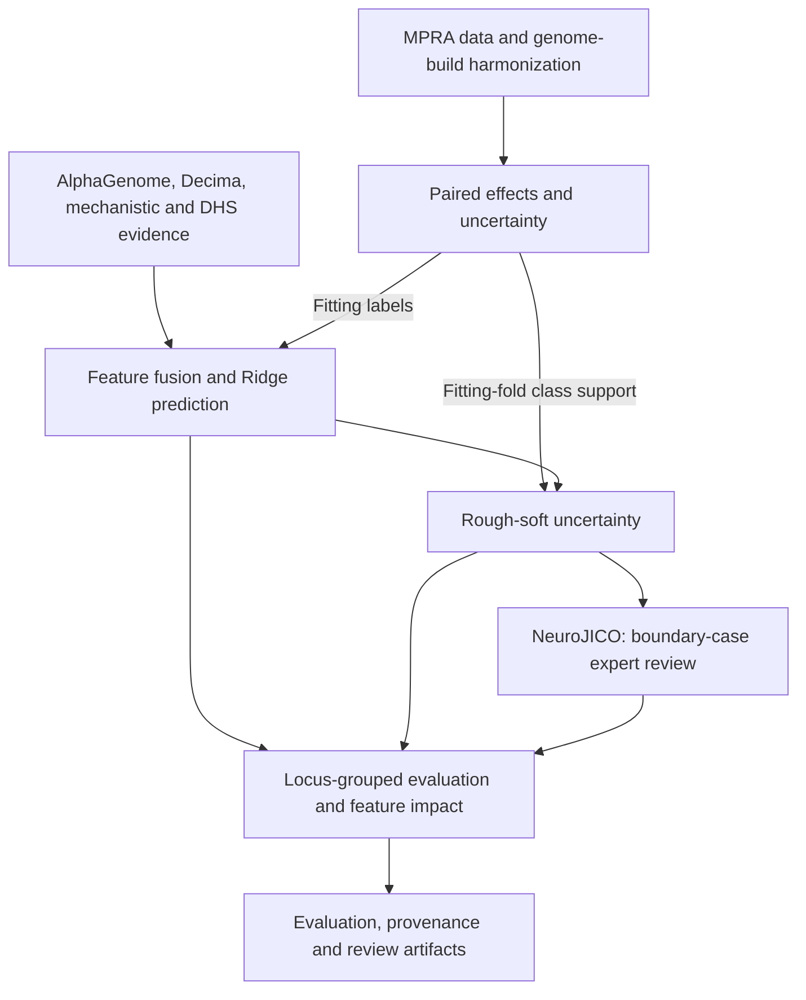

# Regulatory Variant Interpretation Framework

**Context-dependent prediction, integrated molecular evidence, uncertainty, and expert review.**

This research framework studies how a non-coding variant's regulatory effect changes between cellular contexts. It brings together MPRA data preparation, genome-build harmonization, foundation-model and mechanistic evidence, effect prediction, uncertainty analysis, expert-review workflows, and locus-grouped evaluation.

**NeuroJICO is the framework's human–AI collaboration component.** It uses rough-soft boundary cases to select variants for expert review and is evaluated alongside AI alone, rough-soft AI, and an alternative expert-review selection strategy. NeuroJICO is one method within the study; the framework also includes the data, predictors, uncertainty controls, feature-impact analysis, and reproducibility infrastructure shared by these methods.

The [research proposal](docs/regulatory_variant_proposal.md) describes the study and planned expert protocol.

## Scientific scope

The primary endpoint is the **context-transfer delta**, `target_effect - source_effect`, measured on paired MPRA allele effects. Target-context effects are a secondary endpoint. The current study uses Siraj for development and rough-soft precision tuning, and evaluates Ho (Jurkat → primary T cells) and Bourges (resting → stimulated primary T cells) as separate tasks. Supporting another context requires suitable paired measurements and explicit model-context configuration.

The framework combines five evidence blocks:

| Block | Evidence | Interpretation |
|---|---|---|
| `avi` | Local AlphaGenome AVI raw and PHRED scores | Global SNV impact; not a directional, cell-specific expression measurement |
| `tracks` | Cached AlphaGenome RNA-seq, CAGE, DNase, ATAC, and CHIP_TF scores | Per-state score averages; enabled for a dataset when coverage is complete |
| `decima` | Frozen Decima gene-expression deltas | Model-defined cell states, with missing-task proxies declared explicitly |
| `mechanistic` | δSVM and motifbreakR annotations | Available sequence and transcription-factor evidence |
| `dhs` | DNase accessibility annotations | Available chromatin-context evidence |

MPRA effects and their standard errors provide fitting labels and rough-soft class support. Measured target outcomes are excluded from the fused predictor inputs and review cards. A Ridge head predicts the context-transfer delta; the variable-precision rough-soft layer estimates support for maintained, weakened, strengthened, and reversed effects.



## NeuroJICO and the comparison methods

| Method key | Role |
|---|---|
| `ai_alone` | Ridge prediction for every variant |
| `rough_soft_ai` | Rough-soft gating; rejected cases use the source effect as the configured fallback |
| `expert_alone` | Expert-action replacement on a matched budget of variants chosen by a non-VPRS selector; AI elsewhere |
| `neurojico` | Expert-action replacement on rough-soft boundary variants; AI elsewhere |

The `expert_alone` name is retained in result files, but this arm is a budgeted review baseline, not a human prediction for every variant. The comparison tests the selection strategy as well as the prediction workflow.

**Research status:** development evaluation files have been produced locally, but datasets and run outputs are not included in Git. Their presence does not establish improved predictive performance or a completed expert study. The current implementation accepts categorical `accept`, `challenge`, and `defer` actions, with review time specified in configuration. The proposal's blinded study with numeric expert estimates and measured review time remains separate work. Without expert actions, the configured acceptance behavior keeps the AI prediction.

## Repository layout

```text
regulatory-variant-framework/
├── main.py                         # Framework CLI
├── pyproject.toml                  # Package metadata, commands and dependencies
├── requirements-lock.txt           # Version-range constraints, not exact pins
├── regulatory_model/
│   ├── api.py                      # DataFrame fit/predict interface
│   ├── config.json                 # Evidence, context and evaluation settings
│   ├── data_prep.py                # Dataset adapters and validation
│   ├── liftover.py                 # Genome-build normalization
│   ├── dataset_cohorts.py          # Cohort, AVI and track loading
│   ├── decima_scorer.py            # Frozen Decima scoring and provenance
│   ├── model.py                    # Feature blocks, Ridge and rough-soft support
│   ├── pipeline.py                 # Full workflow and comparison methods
│   ├── evaluation.py               # Locus grouping, metrics and selective curves
│   └── reporting.py                # JSON outputs and audit utilities
├── scripts/                        # AVI and cell-state track acquisition
├── tests/                          # Offline compatibility and smoke tests
├── docs/
│   ├── regulatory_variant_proposal.md
│   └── templates/                  # Training and candidate CSV schemas
├── data/                           # Local inputs and model resources; ignored
└── output/experiments/
    └── regulatory-variant-framework/ # Local prepared tables and run outputs; ignored
```

The existing Python package remains `regulatory_model`. Source data, large archives, model resources, virtual environments, credentials, and experiment outputs stay outside version control.

## Installation

Python 3.11 or newer is required. Clone the repository using an account with access, then install from its root:

```bash
git clone https://github.com/Moustafazn/regulatory-variant-framework.git
cd regulatory-variant-framework
python -m venv venv
source venv/bin/activate
python -m pip install --upgrade pip
python -m pip install -e '.[test]'
regulatory-variants --help
```

The main pipeline reads local AlphaGenome annotations. Decima downloads model weights on first use. Install the optional AlphaGenome client for track acquisition:

```bash
python -m pip install -e '.[alphagenome]' biopython
```

The AVI utility uses Biopython for reference/mapping operations and `truststore` for OS-trusted HTTPS certificates. `pysam` is needed only for an already unpacked AVI `.tsv.gz`, not the ZIP-reader path.

## Data preparation

Place the source files in `data/regulatory_audit/` using these filenames:

| File | Source and role |
|---|---|
| `ho_supp.xlsx` | Ho supplementary workbook; [article](https://doi.org/10.1038/s41588-025-02301-3), [GSE297471](https://www.ncbi.nlm.nih.gov/geo/query/acc.cgi?acc=GSE297471); held-out context task |
| `bourges_barcode_counts.txt.gz` | Bourges barcode counts; [article](https://doi.org/10.15252/emmm.202012112), [GSE135925](https://www.ncbi.nlm.nih.gov/geo/query/acc.cgi?acc=GSE135925); held-out context task |
| `siraj_MPRA.zip`, `siraj_tables.zip` | Siraj development data; [article](https://doi.org/10.1038/s41586-026-10121-6), [Zenodo archive](https://zenodo.org/records/15297965) |
| `ho_bourges_shared_rsids.txt` | Audited shared-variant exclusion list, required before evaluation |

Save the Ho supplementary workbook as `ho_supp.xlsx`. The quantitative loader reads this workbook; `ho_normalized_counts.txt.gz` is supporting data, not a required model input. Save the Siraj archive's `data_MPRA.zip` and `tables.zip` using the local filenames above. The overlap list must come from the audited data preparation; an empty placeholder does not provide leakage control.

Download the Bourges counts with:

```bash
mkdir -p data/regulatory_audit
curl -L 'https://ftp.ncbi.nlm.nih.gov/geo/series/GSE135nnn/GSE135925/suppl/GSE135925_barcode_counts.txt.gz' \
  -o data/regulatory_audit/bourges_barcode_counts.txt.gz
```

Prepare each dataset before extracting AVI annotations or requesting tracks:

```bash
python -m regulatory_model.data_prep --dataset ho \
  --root data/regulatory_audit \
  --output output/experiments/regulatory-variant-framework/prepared/ho.csv.gz
python -m regulatory_model.data_prep --dataset bourges \
  --root data/regulatory_audit \
  --output output/experiments/regulatory-variant-framework/prepared/bourges.csv.gz
python -m regulatory_model.data_prep --dataset siraj \
  --root data/regulatory_audit \
  --output output/experiments/regulatory-variant-framework/prepared/siraj.csv.gz
```

The main workflow also prepares these datasets. Genome normalization uses the configured local hg38 FASTA and chain resources when available; inspect the preparation reports' `liftover_to_grch38` field. Prepared tables without a verified GRCh38 normalization must not be treated as validated Decima inputs. Resolve source builds and allele orientation before interpreting scores.

## AlphaGenome AVI annotations

The AVI utility downloads/resumes the approximately 88 GB precomputed archive at `data/alphagenome_avi/avi_scores_snvs_tabix.zip`:

```bash
python scripts/download_alphagenome_avi.py --download-archive
python scripts/download_alphagenome_avi.py --datasets ho bourges siraj
```

It reads the ZIP's stored score member in place and extracts only the small index. It uses `hg38.2bit` and, for Bourges, an hg19-to-hg38 chain and source oligos to resolve coordinates. Archive, reference, mapping resources, and extracted `*.avi.csv.gz` tables remain in `data/alphagenome_avi/`.

Only matched single-nucleotide substitutions enter the AVI cohort; indels and unmatched records are unsupported. The pipeline checks prepared-input hashes before joining the extracted annotations. Both acquisition utilities accept `--prepared-dir` for a custom experiment location.

## AlphaGenome cell-state scores

The track utility requests the configured scorers, averages raw scores by cell-state ontology groups, and writes one NPZ per variant to `data/alphagenome_tracks/`. The current default groups are `primary_T` and `jurkat`, with five modalities per group. A dataset's track block requires complete coverage; use `--require-tracks` in the framework CLI to make incomplete coverage an error.

```bash
export ALPHAGENOME_API_KEY='your-key'
python scripts/download_alphagenome_tracks.py --datasets bourges
python scripts/download_alphagenome_tracks.py
```

The utility defaults to Bourges, Ho, then Siraj and skips existing variant NPZs. Interrupt and rerun to resume. It resolves coordinates before API requests and stores manifests alongside the files. Check the provider's applicable terms before using API-derived outputs in fitted models.

## Run the full framework

Once prepared tables, matched AVI annotations, and the chosen model resources are available:

```bash
regulatory-variants --output output/experiments/regulatory-variant-framework
# Equivalent source-checkout entry point:
python main.py --output output/experiments/regulatory-variant-framework
```

Useful options include:

```bash
# Require complete cached AlphaGenome track coverage.
regulatory-variants --require-tracks

# Declare a reduced-evidence run without Decima inference.
regulatory-variants --skip-decima

# Apply supported, evidence-linked fitting-fold corrections.
regulatory-variants --expert-corrections path/to/expert_corrections.json

# Use an isolated directory for a limited development run.
regulatory-variants --output output/experiments/development \
  --sample-chrom chr1 --sample-per-dataset siraj=200 --sample-per-dataset ho=300
```

`--data-root`, `--avi-dir`, `--tracks-dir`, and `--config` override the resource paths. The default configuration is `regulatory_model/config.json`, under the top-level `framework` key. Context aliases and model-task mappings must be explicit; missing Decima tasks may use configured proxies whose provenance should be inspected.

**An existing output directory is reused:** the runner preserves `prepared/` and `decima_scores/` but replaces other run outputs. Choose a new `--output` directory to keep a prior run intact. Review corrections require an example ID, supported field/value, reason, and HTTPS evidence URL; corrections outside the fitting fold are rejected.

## Python interface

`RegulatoryVariantModel` fits a predictor and rough-soft support model for one source/target context pair. It returns predictions and uncertainty fields for unlabeled candidate variants; it does not conduct an expert study. The DataFrame API uses local AVI columns, optional mechanistic/DHS columns, and Decima. Cached AlphaGenome track NPZs are consumed by the full CLI pipeline, not this in-memory interface.

```python
import pandas as pd
from regulatory_model import RegulatoryVariantModel

training = pd.read_csv('training_variants.csv')
candidates = pd.read_csv('candidate_variants.csv')

model = RegulatoryVariantModel()
model.fit(training)
predictions = model.predict(candidates)
predictions.to_csv('candidate_predictions.csv', index=False)
```

Start from the header-only [training schema](docs/templates/training_variants.csv) and [candidate schema](docs/templates/candidate_variants.csv); populate them with actual data before use.

| Training columns | Requirements |
|---|---|
| `example_id`, `variant_id` | Unique paired-example ID and stable variant ID |
| `chrom`, `position`, `genome_build` | Valid chromosome, 1-based position, and `GRCh38` |
| `ref`, `alt` | Reference/alternate DNA alleles; AVI annotations must match the SNV |
| `source_context`, `target_context` | One context pair matching configured state names, labels, or aliases |
| `source_effect`, `target_effect` | Paired effects on the same scale and orientation |
| `source_se`, `target_se` | Positive standard errors |
| `effect_covariance` | Explicit measurement-error covariance; use zero only when independence is justified; magnitude ≤ `source_se * target_se` |
| `avi_raw_score`, `avi_phred` | Required matched local AVI annotations |

Candidates require `chrom`, `position`, `genome_build`, `ref`, `alt`, `avi_raw_score`, and `avi_phred`. IDs may be supplied or generated. Optional `source_effect` produces `predicted_target_effect` in addition to `predicted_context_transfer_delta`. Keep measured `target_effect` and `target_se` out of candidate inputs.

Optional mechanistic predictors are `delta_svm_nCD4`, the four `motifbreakr_{tcell,jurkat}_alleleDiff_{max,min}` fields, and the two `motifbreakr_{tcell,jurkat}_tf_count` fields. Optional DHS predictors are `dhs_hTH1`, `dhs_hTH17`, `dhs_hTH2`, `dhs_CD4`, `dhs_CD4pos_N`, `dhs_hTR`, `dhs_Jurkat`, and `dhs_CD8`.

Use `RegulatoryVariantModel(use_decima=False)` for a reduced-evidence model, or `beta=0.6` to override rough-soft precision. Prediction requires no AlphaGenome API calls.

## Outputs and interpretation

| Artifact | Contents |
|---|---|
| `evaluation.json` | Four-method metrics, locus-grouped summaries, selective-risk curves, feature-impact summary |
| `feature_impact.json` | Block leave-one-out ΔRMSE, configured ablations, coefficient × feature-standard-deviation attributions |
| `review_cards.json` | Boundary cases with evidence and uncertainty; measured target effects omitted |
| `expert_corrections.template.json` | Categorical correction template when no corrections were supplied |
| `audit.json` | Framework identity, config/data hashes, resource provenance, runtime information and limitations |
| `tuning.json` | Development-set β selection |
| `cross_dataset_overlap_audit.json` | Coordinate and locus-overlap checks |
| `run_log.jsonl`, `folds/`, `prepared/` | Progress events, fitted fold artifacts and prepared datasets |

Run outputs are local, not bundled results. Foundation models remain frozen; only the Ridge and rough-soft components are fitted. Current Decima configuration declares a zero proxy for Jurkat when no atlas task exists. Model-task contexts are not donor-matched measurements. A completed expert panel and measured review times are needed for claims about human–AI benefit.

## Compatibility and verification

The project was previously named `neurojico-rough-set`. The repository and distribution are now `regulatory-variant-framework`; the import package remains `regulatory_model`.

- `NeurojicoModel` remains an alias for `RegulatoryVariantModel`.
- `neurojico` remains a CLI alias for `regulatory-variants`.
- `NeurojicoOptions` and `run_neurojico` remain aliases for `FrameworkOptions` and `run_framework`.
- Legacy configurations with a top-level `neurojico` block still load. Use exactly one of `framework` and `neurojico`.
- The evaluation key `neurojico` continues to identify the NeuroJICO comparison arm.
- New defaults use `output/experiments/regulatory-variant-framework/`. For older runs, set `--output` and the downloaders' `--prepared-dir` explicitly; existing historical files are not rewritten automatically.

Run the offline checks with:

```bash
python -m pytest -q
regulatory-variants --help
```

These checks exercise the Python interface, compatibility, configuration, CLI paths, and audit writing. They do not replace a full MPRA/model-resource evaluation or establish scientific performance. The historical [NeuroJICO illustration](docs/images/neurojico_model.png) is retained as an earlier design artifact; its umbrella branding predates this rename.

## Citation

> Zain, M., & Hassanien, A. E. *Regulatory Variant Interpretation Framework: context-dependent prediction, integrated molecular evidence, uncertainty, and expert review.* Manuscript in preparation.

This is the working project citation, not a published bibliographic record. Update it when the manuscript title and publication details are finalized.
